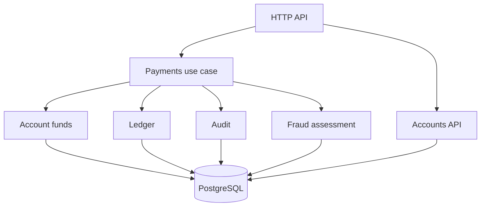

# Sentinel — Payment Processing & Fraud Detection Engine

Educational Java fintech backend for an internship portfolio. Simulation only; no bank accounts,
payment gateways or real funds.

**Phase 3: atomic payments, immutable ledger, configurable fraud rules and decision audit.**
Simulation only: risk weights are educational, not calibrated to real fraud data.
Executed checks and their limitations: [verification](docs/verification.md).

## Stack

Java 21, Spring Boot 4.1.1, PostgreSQL 17.6, jOOQ 3.20.20, Flyway, Maven 3.9.11,
JUnit 5.13.4, Testcontainers 1.21.4, Docker Compose, springdoc 3.0.0 and GitHub Actions.
The Maven Alpine build image avoids a failing local JDK image observed during Foundation setup.
The runtime image is Temurin 21 JRE, running as a non-root user.

## Architecture

One deployable modular monolith. Constructor injection; HTTP controllers are separate from business
use cases. SQL is explicit and all request values are bound parameters. No Kafka, Redis or Kubernetes.



[Payment ADR](docs/adr/002-payment-engine.md) explains the transaction, locking, idempotency and
accounting guarantees. [Architecture](docs/architecture.md) describes module boundaries. [Fraud ADR](docs/adr/003-fraud-engine.md) explains history, scoring and concurrency.

## Data model

| Table | Main fields | Guarantees |
| --- | --- | --- |
| accounts | UUID, name, EUR, BIGINT balance, type | Customer balance >= 0; one SYSTEM_CONTRA |
| transfers | UUID, key, operation, account IDs, amount, status, failure reason | Unique immutable idempotency request; legal status transition |
| ledger_entries | Identity ID, transfer/account IDs, signed cents | Immutable; two matching opposite entries per completed transfer |
| audit_events | Identity ID, transfer ID, status event, time | Append-only received/outcome history |
| fraud_decisions | Transfer ID, version, evaluation time, score, decision, thresholds, rule hits | Immutable; score and status consistency |

Flyway V1 is unchanged. V2 introduces accounting and refuses pre-existing unexplained nonzero balances.
Accounts created during Foundation with zero balance migrate normally. No existing data needs deletion. V3 preserves Phase 2 balances/history, adds fraud requirements for new customer transfers, and leaves funding and legacy transfers without a fabricated decision.

## Run

```sh
cp .env.example .env
docker compose up --build -d
docker compose logs -f app
```

Prerequisites: Docker Desktop/Engine with Compose v2 and internet for images/dependencies.
API: http://localhost:8080. Swagger: http://localhost:8080/swagger-ui.html.
OpenAPI: http://localhost:8080/v3/api-docs.

Ports bind to loopback. `docker compose down` keeps database data. `docker compose down -v` **deletes it**.
Migrations run on application startup. For local Java development, start only `db`, set DB_URL/DB_USER/
DB_PASSWORD to the Compose settings and run `mvn spring-boot:run` under Java 21.

## Controlled demo funding

Default profile has NO HTTP funding route. For a local demonstration, edit `.env`:

```dotenv
SPRING_PROFILES_ACTIVE=demo
DEMO_FUNDING_TOKEN=<your-random-token-of-at-least-16-characters>
```

Set an actual token, not the angle-bracket placeholder. Demo startup fails with an empty/short token.
Recreate the app after changing the profile: `docker compose up -d --force-recreate app`.
Do not commit `.env` or expose this unauthenticated simulation to the internet.

The system contra-account starts at zero. Funding debits it and credits a customer through the same
ledger-backed transaction as transfers. It may be negative; customer balances may not.

## API examples (PowerShell)

```powershell
$a = Invoke-RestMethod -Method Post -Uri http://localhost:8080/accounts `
    -ContentType 'application/json' -Body '{"name":"Demo Alice"}'
$b = Invoke-RestMethod -Method Post -Uri http://localhost:8080/accounts `
    -ContentType 'application/json' -Body '{"name":"Demo Bob"}'

# Put your configured token into this variable locally; never paste it into a public issue.
$demoToken = '<your-configured-token>'
$fundingHeaders = @{ 'Idempotency-Key' = [guid]::NewGuid().ToString(); 'X-Demo-Token' = $demoToken }
$fundingBody = @{ targetAccountId = $a.id; amountCents = 10000 } | ConvertTo-Json
Invoke-RestMethod -Method Post -Uri http://localhost:8080/demo/fundings `
    -Headers $fundingHeaders -ContentType 'application/json' -Body $fundingBody

$headers = @{ 'Idempotency-Key' = [guid]::NewGuid().ToString() }
$body = @{ sourceAccountId = $a.id; targetAccountId = $b.id; amountCents = 2500 } | ConvertTo-Json
$t = Invoke-RestMethod -Method Post -Uri http://localhost:8080/transfers `
    -Headers $headers -ContentType 'application/json' -Body $body
# Same key and body: HTTP 200, same transfer ID, no additional spend.
Invoke-RestMethod -Method Post -Uri http://localhost:8080/transfers `
    -Headers $headers -ContentType 'application/json' -Body $body
Invoke-RestMethod -Uri "http://localhost:8080/transfers/$($t.id)"
Invoke-RestMethod -Uri "http://localhost:8080/transfers/$($t.id)/audit"
Invoke-RestMethod -Uri "http://localhost:8080/transfers/$($t.id)/fraud"
Invoke-RestMethod -Uri "http://localhost:8080/accounts/$($a.id)/transactions?limit=20"
```

Money is integer cents. Fractional JSON amounts are rejected. EUR is implicit; foreign currency fields
and unknown JSON properties are rejected. Keys contain 1–128 printable non-space ASCII characters.
History is newest first; pass returned `nextBeforeId` as `beforeId` for the next page (limit 1–100).

| Outcome | HTTP | Body / behavior |
| --- | --- | --- |
| Create account or complete new transfer/funding | 201 | Resource and Location header |
| New REVIEW transfer | 202 | Transfer with REVIEW status; no reserve or spend |
| New fraud DECLINE | 201 | Created transfer with DECLINED status; no spend |
| Replay REVIEW or DECLINED | 200 | Original transfer and decision; no re-evaluation |
| Replay completed transfer | 200 | Original transfer; Idempotency-Replayed: true |
| Insufficient funds or numeric balance limit | 409 | Stable error containing transferId; persisted REJECTED |
| Replay rejected request | 409 | Same rejection body even if balance subsequently changes |
| Reuse key for different operation/parameters | 409 | IDEMPOTENCY_CONFLICT |
| Invalid JSON/input/header | 400 | Common error format |
| Missing account/transfer/route | 404 | Common error format |
| Wrong demo token | 403 | FORBIDDEN |
| Deadlock/lock timeout/serialization/query timeout | 503 | RETRYABLE_TRANSACTION_FAILURE; Retry-After: 1; retry same key |
| Unexpected failure | 500 | Safe message and errorId; transaction rolled back |

Errors use `timestamp`, `status`, `code`, `message`, `errorId`, `fields`. Unexpected SQL messages and
request bodies are not logged. No balances, names, tokens or idempotency keys are logged by our services.

## Fraud policy

| Rule ID | Default condition | Contribution |
| --- | --- | --- |
| LARGE_AMOUNT | Amount >= 100000 cents (1000 EUR) | 35 |
| VELOCITY | At least 5 previous evaluated attempts in 60 seconds | 30 |
| NEW_RECIPIENT | No completed transfer from this source to this recipient | 20 |
| AMOUNT_DEVIATION | At least 5 completed transfers in 30 days; amount >= 3 × their average | 35 |

Sum contributions, capped at 100: 0–39 APPROVE, 40–69 REVIEW, 70–100 DECLINE.
Settings live under `sentinel.fraud` in `application.yaml`; invalid settings fail startup.
`GET /transfers/{id}/fraud` returns engine version, evaluation time, thresholds and triggered rules
with evidence. Funding and pre-V3 transfers return 404 on this route.

Velocity includes APPROVE, REVIEW and DECLINE decisions, even when an approved attempt was rejected
for insufficient funds. Idempotent replays do not add observations. Funding is excluded.
New-recipient history requires a completed payment, so a reviewed recipient is still new.
Fraud reads happen after ordered account locks; the observation clock comes from PostgreSQL after
waiting. Decimal averages use BigDecimal; no binary floating point is used for money.

REVIEW does not reserve funds and cannot execute by replaying its key. There is no review-approval
endpoint in this phase. DECLINED is permanent. Keep this simulation on localhost: customer endpoints
have no user authentication or authorization.

## Financial invariants

1. Total balances including SYSTEM_CONTRA remain zero.
2. Each completed transfer has exactly two entries matching payer, payee and amount; their sum is zero.
3. Each account balance equals its ledger projection.
4. Customer balances never become negative; arithmetic bounds prevent BIGINT overflow/underflow.
5. A committed idempotency key identifies one immutable request and stable result.
6. Balance changes, ledger, status and audit commit or roll back together.
7. REJECTED, REVIEW and DECLINED transfers have zero ledger entries. Ledger, audit and fraud decisions cannot be updated, deleted or truncated.
8. New customer transfers require exactly one matching fraud decision; completed/rejected payments require APPROVE.

Constraints and deferred triggers enforce these at the database boundary. A database administrator can
still disable triggers; the development owner role is not a production tamper-proof security design.

## Tests

```sh
mvn test    # Unit tests (including independent fraud rules)
mvn verify  # Unit + real PostgreSQL Testcontainers tests
```

`verify` requires a running Docker daemon; no tests silently skip when Docker is absent. Test databases
are independent of Compose data. Integration checks include HTTP contracts, accounting constraints,
parallel identical requests, overspending, opposite-direction transfers, failure during the second
ledger write, stable rejection replay, lock timeout, immutable history and integer bounds.
Fraud tests additionally cover scoring boundaries, concurrent velocity decisions, REVIEW/DECLINE replay, immutable decisions, decision-write rollback, expired windows and upgrading a populated V2 database.
CI runs verify, a Docker Compose payment and fraud smoke check, and retains reports. Execution status is in [verification](docs/verification.md).

## Limits and next steps

No authentication for customer API, KYC/AML, gateway integrations, FX, fees, reservations, reversals,
manual review workflow, production roles/backups or distributed operations. No performance claims.
Funding is an accounting simulation, not an external settlement integration.

Phase 4: measured load, bottleneck analysis, final review and reproducible demo.

Learning exercise: [docs/learning.md](docs/learning.md).
