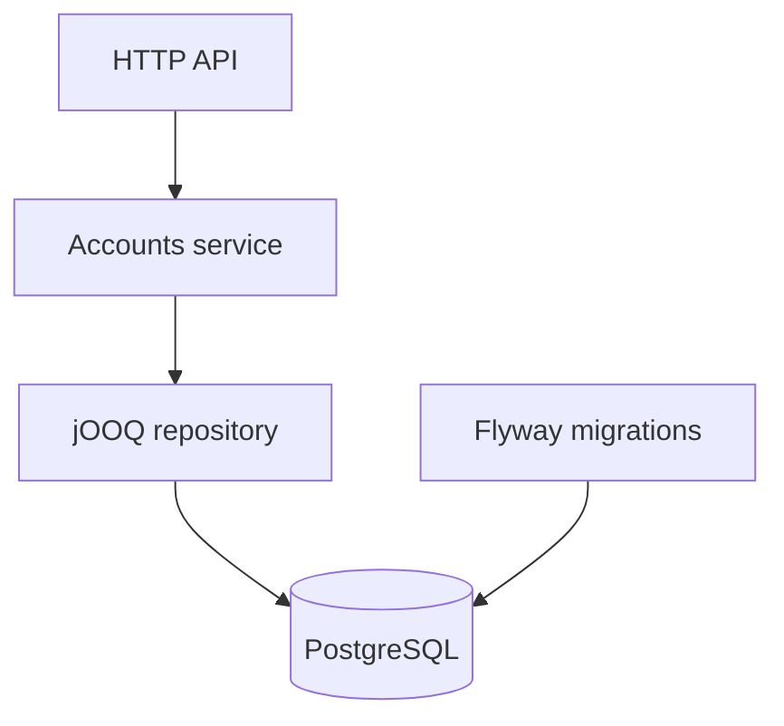

# Sentinel — Payment Processing & Fraud Detection Engine

Educational fintech backend for a Java internship portfolio. Simulation only; no banking integrations or real money.

**Status: Phase 1 implementation. Verification status: see [docs/verification.md](docs/verification.md).**
Payments, funding, ledger, fraud scoring and transaction history are not implemented yet. Do not claim those features in a CV.

## Stack

Java 21, Spring Boot 4.1.1, PostgreSQL 17, jOOQ, Flyway, Maven 3.9.11, JUnit 5.13.4,
Testcontainers 1.21.4, Docker Compose, springdoc OpenAPI 3.0.0, GitHub Actions.
Versions are pinned or managed by the Boot BOM. JUnit 5 and Testcontainers 1.x are explicit BOM overrides.
Maven was selected for a conventional build with no additional build language.

## Architecture

One deployable application, packages grouped by responsibility. Currently only `accounts` and shared HTTP error handling exist.



Planned boundaries and payment design: [architecture](docs/architecture.md).
HTTP controllers validate requests; services own use cases; repositories own SQL. No JPA, Kafka, Redis or Kubernetes.

## Data model implemented

| accounts column | SQL type | Guarantee |
| --- | --- | --- |
| id | UUID | Primary key |
| name | VARCHAR(100) | Required, nonblank |
| currency | VARCHAR(3) | EUR only |
| balance_cents | BIGINT | Nonnegative; starts at zero |
| created_at | TIMESTAMPTZ | Database timestamp |

No API accepts an initial balance or updates balances. There is no seed money in Foundation.
This keeps funding out of the project until ledger-backed transactions exist.

## Run

Prerequisite: Docker Engine/Desktop with Compose v2; internet for Maven and image downloads.

```sh
cp .env.example .env
docker compose up --build -d
docker compose logs -f app
```

API: http://localhost:8080. Swagger: http://localhost:8080/swagger-ui.html.
OpenAPI JSON: http://localhost:8080/v3/api-docs.
Ports bind to loopback. Database data persists across restarts. `docker compose down` preserves data;
`docker compose down -v` **deletes all local simulation data**.

For Java development, install JDK 21 and Maven 3.9.11 (or compatible Maven 3.9.x):

```sh
docker compose up -d db
# .env is consumed by Compose, not automatically by Spring Boot.
# Set these explicitly to match your .env when running outside Docker.
export DB_URL=jdbc:postgresql://localhost:5435/sentinel
export DB_USER=sentinel
export DB_PASSWORD=sentinel-local-only
mvn spring-boot:run
```

Windows PowerShell equivalent for each variable: `$env:DB_PASSWORD = "sentinel-local-only"`.
Flyway applies migrations on startup. Java 21 is enforced by the build.

## API examples

```sh
curl -i -X POST http://localhost:8080/accounts \
  -H 'Content-Type: application/json' -d '{"name":"Demo Alice"}'
# 201 Created, Location: /accounts/<UUID>
curl http://localhost:8080/accounts/<UUID>
```

Response fields: `id`, `name`, `currency`, `balanceCents`, `createdAt`.
Name is stripped of surrounding whitespace and limited to 100 Unicode code points.

Errors use one structure:

```json
{"timestamp":"2026-10-14T00:00:00Z","status":404,"code":"NOT_FOUND","message":"Account not found","errorId":"<UUID>","fields":{}}
```

Invalid JSON/name/UUID: 400. Unknown account/route: 404. Unsupported method: 405. Unsupported media type: 415. Unexpected failure: 500 with safe message and logged errorId.
The example timestamp is illustrative. IDs are not authentication credentials.

## Tests

```sh
mvn test    # Unit tests, including name normalization and boundary conditions
mvn verify  # Unit tests + real PostgreSQL via Testcontainers + packaged application
```

Docker must be running for `verify`. Integration tests are named `*IT` and run through Failsafe.
Tests do not silently skip when Docker is absent. No H2 substitution is used.
The database supplied by Testcontainers is isolated from Compose data.
CI is configured to run `verify`; a workflow file is not evidence of a successful CI run.

Integration cases: create/read over HTTP, response Location, zero initial balance, invalid inputs,
missing accounts, direct SQL constraint violations, OpenAPI generation.

## Financial invariants: Phase 2 acceptance criteria

Not yet implemented or verified:

1. Each committed transfer has exactly two immutable, opposite signed ledger entries summing to zero.
2. Balances equal the sum of ledger entries for each account.
3. Customer balances never become negative.
4. Total balance, including the system contra account, is conserved.
5. Identical idempotency key and parameters replay one persisted result; changed parameters conflict.
6. Balance changes, ledger, transfer status and audit commit or roll back together.
7. REVIEW and DECLINED payments never write monetary ledger entries.

## Simulation limits

No authentication/authorization, real KYC/AML, bank gateways, currencies besides EUR, deployment hardening,
backup strategy or distributed operations. This API must remain local. Customer display names are fictional.
Compose credentials and container database privileges are for local development only.
Structured logging avoids payloads and SQL exception messages. Financial history and persistent audit are future work.
No performance measurements have been made.

## Roadmap

1. Foundation: prove schema/API/unit and PostgreSQL tests.
2. Payments: double entry, demo system funding, transaction lifecycle, idempotency, ordered row locks,
   rollback and concurrency tests.
3. Fraud: independent deterministic rules, configurable risk bands, persisted decisions and audit.
4. Quality: measured load tests, bottleneck analysis, final documentation and demonstration.

See [ADRs](docs/adr/001-foundation.md), [learning task](docs/learning.md) and [verification](docs/verification.md).
